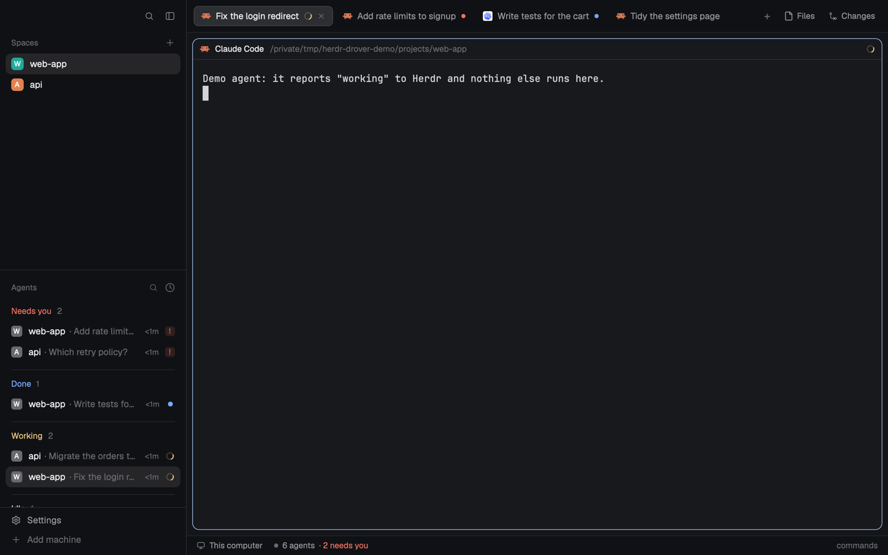

# Drover

A Herdr layout for running many agents at once. Unnamed tabs are called by the title
the agent set (Claude's "✳ Fix the login redirect" reads "Fix the login redirect"),
the sidebar holds your spaces above an agent list grouped by what needs you, and a
handful of keys make tabs behave the way they do in a browser.

## Install

Ask your agent in Herdr: "add the layout github.com/bborn/herdr-drover". It will
read [RECIPE.md](RECIPE.md), copy `layouts/` and `mods/` into your Herdr folder,
merge `keys.json` into yours, and switch to it. Your own layout stays as it was, and
`ctrl-shift-l` switches back.

To do it by hand, copy `layouts/drover.json` to `~/.config/herdr-app/layouts/`, the
`mods/drover-*` folders to `~/.config/herdr-app/mods/`, merge the sections of
`keys.json` into `~/.config/herdr-app/keys.json`, then run
`herdr-app do layout.switch '{"name":"drover"}'`.

## Keys (macOS)

| Key | What it does |
|---|---|
| ⌘T | New tab in the space's own folder |
| ⌘W | Close the tab, after asking. Its terminals keep running for a while so you can bring it back |
| ⌘⇧T | Reopen the last closed tab, with its agents still running |
| ⌘⌥P | Pin or unpin the tab's agent at the top of the agent list |
| ⌘\\ | Put the keyboard back in the tab's terminal |
| ⌘⇧\\ | Filter the agent list: `[space]`, `is:blocked`, `@machine` or any text |
| ⌘⇧B | Show or hide the spaces list |

The keys are for macOS only. On Linux or Windows, change `cmd` to `ctrl` and pick
keys that don't clash with your terminal.

## Before you install

Some of these mods run programs on your machine:

- `drover-spaces` runs `git status` and `git rev-parse` in each space's folder to
  show its branch, on whichever machine the space is on, and watches the repo's
  folder so the branch stays current. It also runs `hc machine` commands to list
  your machines and to reconnect one when you ask it to.
- `drover-close-tab` runs `mkdir`, `sh` and its own `reap.sh`, which calls
  `herdr-app ls` and `herdr-app do terminal.kill` to end a closed tab's terminals
  once the reopen window has passed.
- `drover-reopen-tab` runs `~/.local/bin/herdr-app do` and `rm`.

Closed tabs are remembered in `data/tab-undo/` inside your Herdr folder. None of
the mods make web requests.

## Try it without installing

`scripts/demo.sh` opens a second Herdr window with Drover and a few demo agents. It
has its own Herdr folder and its own herdr-core session, so your spaces and
terminals aren't affected. `scripts/demo.sh stop` closes it and deletes its folder.

## Changing it

The spaces list and agent list can give each space a fixed logo and color: fill in
`ICONS` and `SPACE_COLORS` near the top of `mods/drover-spaces/main.js`, and the
same tables in `mods/drover-agents/main.js`.

## License

Apache-2.0. `drover-chrome`, `drover-spaces`, `drover-agents` and `drover-tabs`
are modified copies of mods that ship with [Herdr](https://herdr.dev), which is
also Apache-2.0; [RECIPE.md](RECIPE.md) lists what changed in each.
