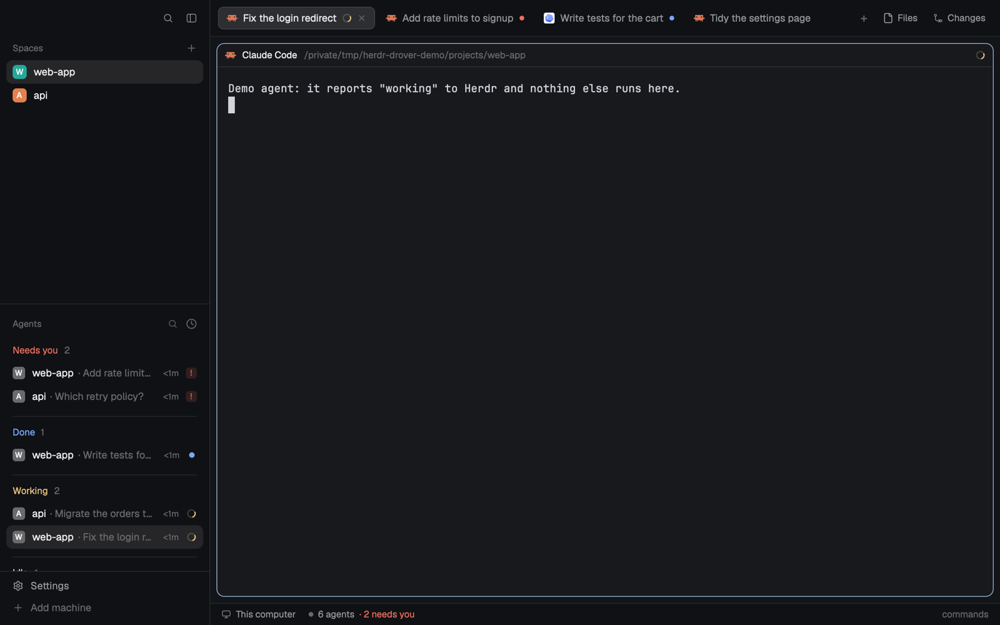

# Drover

Herdr's main layout, tuned for running many agents at once. On the left you get a sidebar with your spaces on top and every agent below them, and you can filter the agents by space, status, machine or text. Across the top, each tab is named after what its agent is doing (Claude's "✳ fix login" reads "fix login"), and you can drag tabs to reorder them. Closing a tab with ⌘W asks first and keeps its agents running for 30 minutes, so ⌘⇧T can bring the tab back with everything still alive. The Herdr logo and name are gone from the top of the sidebar.

## What you see

Left to right, the window is a 268 px sidebar and the work area, split by a 1 px `border` line. There is no title bar (`titlebar: "none"`); on macOS the window buttons are drawn at `[12, 16]`. The window background is `canvas`, and the layout sets no theme or fonts, so it uses the person's own.

### Sidebar (268 px, on `chrome`)

Top to bottom:

- **Top row**, 46 px, which drags the window. On macOS (outside full screen) it leaves 76 px on the left for the window buttons, then an empty spacer, then two 26 px buttons with 15 px `muted` icons and radius 6: search (opens Herdr's picker) and a sidebar toggle. Hovering a button fills it with `hover` and turns the icon `foreground`. The shipped layout shows a 20 px Herdr logo and "Herdr" here; Drover shows nothing.
- **Spaces**, half of the remaining height (at least 90 px).
  - A 31 px header: "Spaces" at 11.5 px `dim`, 16 px in, and a 26 px `+` button on the right that starts a new space.
  - One 30 px row per space (radius 8, 8 px side padding), the active one on `selected`. Each row has an 18 px avatar with radius 5: the space's first letter in 10.5 px bold `#ffffff` on its color, then the name at 13 px `foreground` (up to 150 px), then, right-aligned at 11.5 px `dim`, only what's unusual about its git checkout: the repo name when it differs from the space's name, the branch unless it's `main`, `master` or the space's own name, `↑N` ahead in `ansi2` and `↓N` behind in `ansi1`.
  - Avatar colors are picked once per space and kept, spreading six colors evenly: `#22a99a`, `#e3814f`, `#5b8def`, `#8b7cf6`, `#3fae6a`, `#d9649a`. The `~` space doesn't get one and stays `#22a99a`.
  - A space whose folder is a git worktree of another space's repo moves under that space: a 28 px row indented 22 px with a 13 px branch icon in place of the avatar.
  - Once Herdr knows another machine, the list groups spaces under 26 px machine headers ("This computer" first, then each machine by name, 11 px `dim`): a 13 px monitor or server icon, the name, the machine's state when it isn't connected, a `+` for a new space there, a 6 px dot (`ansi2` connected, `dim` otherwise) and a fold chevron. An empty machine shows "New space there".
- **Agents**, the other half (at least 90 px), with a 1 px `border` line on top.
  - A 41 px header: "Agents" at 11.5 px medium `dim`, 16 px in. On the right, a 14 px search icon (`foreground` while the filter is open) and a 14 px sort icon (a clock for Priority, layers for Grouped by space).
  - The **filter bar**, while open: 28 px tall, 12 px in from each side, radius 7, on `surface` with a 1 px border (`accent` while a filter applies, `input` otherwise). It holds a 12 px search icon, the text field (12.5 px, placeholder `[space] is:blocked @laptop text`) and a `×`. Finished filters show as pills: 5 px padding, radius 5, on `hover` (`selected` when selected), 12 px medium, with a 13 px space tile or status dot in front.
  - A **suggestion list** under the filter bar while you type a filter: radius 7, `input` border, on `surface`, 24 px rows at 12 px with a hint at 11 px `dim`. The highlighted row is on `selected`.
  - The list itself. In **Priority** view (the default) it has sections "Needs you", "Done", "Working" and "Idle", each header in its status color (Idle in `foreground`) with a count. In **Grouped by space** view each space is a section, with a 16 px space tile before its name. Pinned agents come first under "Pinned" in both views.
  - Section headers are 28 px, 12 px semibold. From the second section on, a 1 px `border` hairline sits above the header (8 px in, 10 px above, 6 px below).
  - Agent rows are 30 px, radius 8, with a 9 px gap: an icon, the name (13 px, `muted` when idle and not shown, `foreground` otherwise, up to 200 px), the machine name at 10 px `dim` for an agent on another machine, the time since its state changed at 11 px `dim` ("<1m", "5m", "2h", "3d"), and its status on the right. The agent you're on is on `selected`.
  - The row icon: an emoji at the start of the tab's name (a tab named "🛟 support" shows 🛟 and reads "support"), else in Priority and Pinned a 16 px space tile followed by "space · detail", else the program's 16 px icon.
  - A space tile is the space's first letter or digit in white on a rounded square (radius a quarter of its size). It's `dim` gray unless the space has a color in the mod's `SPACE_COLORS` table, which is empty here.
  - Sub-agents list under their parent as 26 px rows, 39 px in, with 1.5 px `input` tree lines, a 14 px icon, their name in `muted` and their status.
  - With no agents: "No agent status yet. Agents show up here when they report their status. Older versions and agents inside tmux may not." With a filter that matches nothing: "No agents match."
- **Footer**, 69 px, with a 1 px `border` line on top: two 28 px rows with 14 px icons at 13 px, "Settings" (`muted`, with a 6 px `accent` dot when an update is ready) and "Add machine" (`dim`).

When the sidebar is narrower than 160 px it becomes a rail: spaces show their number and a `●` (blocked or done) or `·` in their status color, agents show their number and status, and a `»` at the bottom of the agents list widens it again.

### Work area

Top to bottom:

- **Tab bar**, 47 px, on `chrome` with a 1 px `border` line under it; it drags the window. On macOS it leaves room for the window buttons when the sidebar is too narrow to cover them.
  - Tabs are 29 px, 10 px padding, radius 7, 3 px apart, 12.8 px text. The shown tab is on `raised` with a 1 px `border` outline and `foreground` text; the others are on `chrome` in `muted`.
  - Each tab has the program's 14 px icon, its name (up to 170 px, " Z" added when zoomed), a 12 px spinning `working` spinner while an agent works, a 6 px dot in `blocked` or `done`, and on the shown tab a 12 px close `×` in `dim`.
  - A tab nobody named shows the title its program set, with any leading glyphs stripped, so "✳ fix login" reads "fix login". With no title it shows the program's name, then "Terminal".
  - After the tabs: a 26 px `+` (Herdr's new menu, 250 × 512), then "Files" and "Changes" buttons (26 px, 12 px, 14 px icons, on `selected` while that panel shows). On Windows and Linux without system window buttons, minimize, maximize and close follow.
- **Body**, with 8 px padding and 8 px gaps:
  - **Main**: the shown tab's panes. Each pane has radius 10, a 1 px `border` outline (1 px `accent` when focused), 8 px between panes, and Herdr's 30 px pane header always on top, even for a lone pane. Terminals have 14 px × 12 px padding on `background`.
  - **Side panel**, 368 px (280 to 900), hidden at start: Herdr's Files or Changes.
- **Status bar**, 28 px: Herdr's workspace status.

### Close dialog (⌘W)

A 440 × 190 dialog on `popover`, 18 px padding: `Close tab "{name}"?` at 15 px semibold with "Esc" at 11 px `dim` on the right, then at 13 px `muted` "Running: claude (working), zsh. You can reopen it with ⌘⇧T for 30 minutes.", plus "It's the last tab in {space}, so the space will close too." when it is. Two 32 px buttons with radius 8 at 12 px: "Cancel" on `raised` and "Close tab  ↵" on `solid`.

## How it behaves

- **Agent status**, the same in the agents list, its rows and its sections:

  | State | Agents list | Tab bar |
  |---|---|---|
  | working | 12 px spinner in `working`, one turn per 900 ms | the same spinner |
  | blocked | a "Needs you" pill: 18 px, 10.5 px semibold `blocked` on `blocked` at 15%; in the Priority view's Needs you section a 14 px "!" square | 6 px `blocked` dot |
  | done | 7 px `done` dot | 6 px `done` dot |
  | idle | 7 px ring, 1.5 px `idle` border, and a `muted` name | nothing |

  A sub-agent's error counts as blocked and its done counts as idle. A parent ranks as its most urgent sub-agent. A done agent you look at turns idle but stays in Done until you leave it.
- **Agents list.** Click a row to go to that agent's pane; click a sub-agent to peek at it. Hovering a row swaps its time for a 13 px pin button ("Pin to the top" / "Unpin"). A parent with sub-agents has a fold chevron; folded, it shows how many in the most urgent one's color. Clicking a parent's icon folds it too. Clicking a section header folds the section; folded, it shows the count, the most urgent status (Grouped view) and a chevron. The sort icon opens a 200 px menu, "Sort agents", with Priority and Grouped by space; the choice is kept for every agent list.
- **Filtering.** ⌘⇧\\ or the search icon opens the filter and puts the cursor in it; clicking the icon again or `×` closes it and returns the keyboard to your pane. The filter understands:
  - `[name]`: agents in spaces whose name contains or fuzzily matches it. An unclosed `[na` works while typing. Several are OR'd.
  - `is:` or `status:` followed by `blocked`, `working`, `done`, `idle`, `active` (anything but idle), `pinned` or `unpinned`. `needs` and `waiting` mean blocked, `running` and `busy` mean working, `finished` means done. Several statuses are OR'd.
  - `@name`: the machine an agent runs on. `@local`, `@here` and `@localhost` mean this computer. Several are OR'd.
  - Any other word must appear in, or fuzzily match, the space name, tab label, agent title or program name. Words are AND'd.

  An empty filter suggests `[space]`, `is:status` and `@machine`. Typing after `[`, `is:` or `@` suggests space names, statuses or machines (up to 8, best match first). A plain word of two letters or more suggests up to 6 spaces and machines it could mean, with none picked until you press ↓, so Enter alone keeps it as text. ↑/↓ move through suggestions, Tab or Enter takes one and turns it into a pill (deleted whole with Backspace), and clicking a suggestion takes it too. Without a choice to make, ↑/↓ move a 1 px `accent` outline through the matching agents.
- **Keyboard in the list.** Enter in the filter hands the keyboard to the list: ↑/↓ move the outline (wrapping), Enter goes to that agent and keeps the keyboard in the list, Esc clears and closes the filter, and `/` or Tab goes back to typing.
- **Tabs.** Click to show a tab. Double-click renames it. Right-click opens Herdr's tab menu. The scroll wheel over the bar goes to the next or previous tab. Click `×` on the shown tab to close it at once (this skips the dialog and can't be undone with ⌘⇧T).
- **Dragging tabs.** Press a tab and move 4 px: it lifts into a copy that follows the pointer (95% opaque with a large shadow, 50% while the pointer is off the bar), and a 50% `hover` placeholder with a `border` outline holds its slot. The other tabs slide aside over 160 ms (ease-out) as the pointer crosses their middles. Release to drop it there. The cursor is a closed hand while dragging. Let go off the bar and the drag is dropped without moving anything at the next move over the bar or the next press.
- **Spaces.** Click to switch, right-click for Herdr's space menu, and drag a row onto another in the same machine group to reorder (the dragged row dims to 50% and a 2 px `accent` line shows where it goes). The git details update when a command or an agent's turn ends there, when you `cd`, when the repo's `.git` folder changes, and at most once a minute while the window is in front. Clicking a machine header folds it. When a machine was rebuilt, its header shows "rebuilt ·" and a Connect button that removes and re-adds it.
- **Side panel.** Files and Changes open or close the panel, and each space remembers its own choice.
- **Sidebar toggle.** It narrows the sidebar to a rail (76 px on macOS, 44 px elsewhere) or restores the width it had (268 px the first time).
- **⌘W** opens the close dialog for the shown tab. Enter or "Close tab" closes it, Esc or Cancel keeps it. Closing takes the tab's terminals off screen but leaves them running, and a 6 s toast says `Closed tab "{name}"` with "Press ⌘⇧T within 30 minutes to reopen it." Clicking the toast reopens the tab. After 30 minutes the terminals are ended unless the tab was reopened or closed again since. A tab with no terminals closes right away.
- **⌘⇧T** reopens the most recently closed tab whose terminals are still running. A 320 × 60 popup 40 px from the top says "Reopening…" while it works. It goes back to the tab's space, makes a tab from the first terminal, puts the others to its right, restores its name (or leaves it unnamed), moves it to its old position and focuses the first terminal. If the space has closed since, the tab opens in the current space with a toast: `Reopened "{name}" here`, "Its space, {space}, had closed." With nothing to reopen you get "No closed tab to reopen". Up to 20 closed tabs are remembered.
- **⌘T** opens a new tab in the shown space, started in the space's folder. If the focused terminal is in a subfolder of it (or the folder itself), the new tab starts there.
- **⌘⌥P** pins the shown tab's agent to the top of the agent lists, or unpins it: the focused terminal's agent, else the first agent in the tab. With no agent it says "Nothing to pin".
- **⌘\\** puts the keyboard back in the shown tab's pane, from the agents list or anywhere in the sidebar.
- **⌘⇧B** shows or hides the Spaces list, leaving the agents list the whole height.
- **⌃⌘R** opens a 340 × 64 popup 40 px from the top, on `popover`: "Pane 1/2" at 13 px semibold `foreground` on the left, then key caps (radius 4, on `hover`) for ←, →, = with "even", and Esc, at 12 px `muted`. ← or `h` makes the focused pane the next smaller step of 1/4, 1/3, 1/2, 2/3 and 3/4, → or `l` the next larger one, and it stops at either end. `=` gives every pane in the tab the same size. Esc or Enter closes it. The commands `drover-pane-size.smaller`, `.larger` and `.even` do the same while it's open. With one pane in the tab it says "Nothing to resize" and closes.

## Built from

- **Layout tree** (`layouts/drover.json`), a clone of Herdr's `main` layout from 0.1.12 (`cloned_from: {name: "main", version: "0.1.12"}`). Root: a `row` with `background: "canvas"`, `terminal_padding: [14, 12]`, a 1 px `border` divider, `titlebar: "none"` and `traffic_lights: [12, 16]`.
  - `sidebar`: a column, 268 px (min 44, max 480), `background: "chrome"`, `resizable: false`:
    - `brand`: 46 px block, `window_drag`, mod `drover-chrome`.
    - `sidebar-lists`: a column of `spaces` (mod `drover-spaces`) and `agents` (mod `drover-agents`), each weight 1, min 90.
    - `sidebar-footer`: 69 px block, the shipped mod `workspace-chrome` with `props: {footer: true}`.
  - `work`: a column, `resizable: false`:
    - `tabs`: 47 px block, `window_drag`, mod `drover-tabs`. This is the only size that differs from `main`, where it's 42 px.
    - `work-body`: a row, padding 8, gap 8, of `main` (`tab: "active"`; pane header mod `pane`, `reveal: "always"`, height 30, top; pane background `background`, border 1 `border`, focus 1 `accent`, radius 10, gap 8, `lone: true`) and `panel` (a column, 368 px, min 280, max 900, `hidden: true`) holding `panel-body`, a stack of `files` and `changes` (shipped mods), `active: "files"`.
    - `status`: 28 px block, the shipped mod `workspace-status`.
- **Clones of shipped mods** (all `place: "none"`):
  - `drover-chrome`, from `workspace-chrome` 0.1.12. The one change: the logo and "Herdr" in the top row are replaced by an empty `flex_1` spacer, and its icons load from its own folder. Its footer mode is unchanged and unused here, since the layout uses the shipped `workspace-chrome` for the footer.
  - `drover-spaces`, from `spaces` 0.1.12. Changes: an `ICONS` table (space name in lowercase to an image path, drawn as an 18 px radius-5 picture in place of the letter avatar) and a `SPACE_COLORS` table (space name in lowercase to a hex color, written into `shared("space.colors")` over the automatic pick). Both are empty, so it looks and works like the shipped one.
  - `drover-agents`, from `agents` 0.1.12. Changes: the filter bar with its grammar, suggestions, pills and keyboard list (the `filter` and `clear` commands come through `nextCommand()`); space tiles (with the same empty `SPACE_ICONS` and `SPACE_COLORS` tables) in Priority and Pinned rows, in Grouped headers and in pills; a leading emoji in a tab name used as the row icon; restyled section headers (28 px, 12 px semibold, `foreground` labels, hairlines between groups, where the shipped one is 30 px with 8 px on top, 11 px medium, `dim`); the list's scrollbar shows only while scrolling (`mode("scrolling")`, shipped `"always"`); and the sort menu opens as `drover-agents`.
  - `drover-tabs`, from `tabs` 0.1.12 (no `cloned_from` in its `mod.json`). Changes: unnamed tabs show their program's title with leading non-letter, non-digit characters removed (`/^[^\p{L}\p{N}]+/u`), where the shipped one shows the tab's number; the drag with a lifted copy, placeholder and sliding tabs, where the shipped one moves a tab on release with nothing drawn while dragging; it writes `shared("tab.drag")` (`{id, space, name}`) while a tab is lifted and `null` after; and window button icons load from its own folder.
- **Keyboard mods** (`place: "none"`, each an overlay so a key can open it):
  - `drover-new-tab`: popup 10 × 10 at the top. Runs `tab.new {space, folder}` and closes.
  - `drover-close-tab`: dialog 440 × 190. Runs `terminal.park` per terminal (or `tab.close {id, confirmed: true}` with none), keeps the closed tab in `shared("tab-undo.closed")` (space, name, `named`, index, terminals, `closedAt`; 20 at most), writes a token file per terminal and starts `reap.sh` in the background. `drover-close-tab.confirm` presses Close.
  - `drover-reopen-tab`: popup 320 × 60, `at: "top"`, offset 40. Runs `space.select`, `terminal.keep {terminal, place: "tab"}`, `terminal.keep {place: "right"}`, `tab.rename`, `tab.move {id, index}` and `pane.focus {terminal}` through the `herdr-app do` command line, since it needs the new tab's id back.
  - `drover-pin-tab`: popup 1 × 1. Runs `terminal.pin {terminal, pinned}` and shows a 2 s toast ("Pinned" or "Unpinned").
  - `drover-focus-main`: popup 10 × 10 at the top. Runs `pane.focus {pane}`.
  - `drover-pane-size`: popup 340 × 64, `at: "top"`, offset 40. Runs `layout.resize {id: <pane>, weight}`, which accepts a pane id and sets its weight within its split: the focused pane gets `share × others / (1 − share)` and every other pane in the tab gets 1. Each pane's last step is kept in `shared("drover-pane-size")`, since mods can't read a pane's size; a pane nobody stepped starts from 1/2.
- **Keys** (`keys.json`), all in `global` except one:

  | Key | Action |
  |---|---|
  | `cmd-t` | `mod.open:drover-new-tab` |
  | `cmd-w` | `mod.open:drover-close-tab` |
  | `cmd-shift-t` | `mod.open:drover-reopen-tab` |
  | `cmd-alt-p` | `mod.open:drover-pin-tab` |
  | `cmd-\` | `mod.open:drover-focus-main` |
  | `cmd-shift-b` | `layout.toggle:spaces` |
  | `ctrl-cmd-r` | `mod.open:drover-pane-size` |
  | `cmd-shift-\` (in `layout:drover`) | `drover-agents.filter` |

- **Shipped mods used**: `workspace-chrome` (the footer, and the icons `branch`, `monitor`, `server`, `plus`, `chevron-down`, `chevron-right`, `search`, `spinner`, `pin`, `pin-off`, `clock`, `layers` and `check` that `drover-spaces`, `drover-agents` and `drover-tabs` load from `mods/workspace-chrome/`), `pane` (the pane header and `mods/pane/close.svg`), `files` and `changes` (the panel and `mods/files/file.svg`, `mods/changes/changes.svg`), `workspace-status`, `menu`, `new-menu`, `picker`, `machine-add`, and `toast` for notifications.
- **herdr API**: `spaces`, `panes`, `agents`, `terminals`, `focused`, `machines`, `layout`, `theme`, `window`, `settings`, `updates`, `shared`, `setShared`, `setAgentOrder`, `run`, `exec`, `hc`, `watchFolder`, `openOverlay`, `closeOverlay`, `props`, `notify`, `nextCommand`, `appHome`, `home`, and gpui-base `InputState` / `Input` with tokens.
  - Commands: `space.new`, `space.select`, `space.move`, `tab.new`, `tab.select`, `tab.move`, `tab.rename`, `tab.close`, `tab.next`, `tab.prev`, `pane.focus`, `terminal.peek`, `terminal.pin`, `terminal.park`, `terminal.keep`, `terminal.kill`, `layout.resize`, `layout.select`, `layout.show`, `layout.hide`, `layout.toggle`, `mod.open`, `app.settings`, `window.minimize`, `window.maximize`, `window.close`.
- **Programs**: see Watch out.
- **Art**: no art of its own. `drover-chrome` and `drover-tabs` carry copies of the shipped icons (Lucide-style SVGs) and the Windows window button glyphs.

## Watch out

- **Programs it runs.** Tell the person before adding it:
  - `drover-spaces` runs `git --no-optional-locks -c core.fsmonitor=false status --porcelain=v2 --branch`, `git rev-parse --show-toplevel` and `git rev-parse --path-format=absolute --git-common-dir` in each space's folder, on that space's machine (`exec` with `on`). It runs `hc machine ls --json` every 15 s, and `hc machine rm` then `hc machine add` when you click Connect on a rebuilt machine. It watches local repos' `.git` folders with `watchFolder`.
  - `drover-close-tab` runs `mkdir -p`, `sh -c 'printf …'` to write token files, and `sh -c 'nohup reap.sh …'`. `reap.sh` runs `sleep 1800`, `cat`, `herdr-app ls | grep`, `herdr-app do terminal.kill` and `rm`, with `~/.local/bin` added to its `PATH`.
  - `drover-reopen-tab` runs `~/.local/bin/herdr-app do …` and `rm -f`. On macOS an installed Herdr creates that symlink itself; elsewhere, or from a disk image, it may be missing and reopening fails.
  - Close and reopen keep state in `<app home>/data/tab-undo/` (one token file per parked terminal) and in `shared("tab-undo.closed")`.
- **`reap.sh` must stay executable**, and it finds out whether a terminal is back on screen by grepping `herdr-app ls` for `"terminal": "<address>"`, which depends on that output's pretty-printed JSON. A parked terminal is only ended if this `sh` process lives through the 30 minutes.
- **The keys are macOS only** (`cmd-`). They sit in `global`, so ⌘T and ⌘W replace Herdr's `tab.new` and `tab.close` in every layout, and ⌘⇧B does nothing in a layout without a node named `spaces`. Merge them into the person's `keys.json` and ask before replacing keys they use.
- **Dragging a tab to another space doesn't work.** The comment in `drover-tabs` says the spaces list reads `tab.drag` for that, but `drover-spaces` never reads it, and moving a tab to another space needs `tab.move` with `space`, which 0.1.12 doesn't have. Only reordering within a space works.
- **The drag follows the pointer only over the tab bar.** `drover-tabs` checks for `on_window_mouse_move`, which released Herdr doesn't have, and falls back to the bar's own moves. A build doesn't need the window-wide branch.
- **⌃⌘R is exact only for panes side by side.** Mods can't see how a tab is split, so the weights assume every pane in the tab shares one row or one column. In a nested split the sizes come out roughly right at best. If you drag a divider, the next step starts from the last size ⌃⌘R set, not from what you dragged to.
- **Only ⌘W can be undone.** The tab's `×` and the tab menu's Close end the tab's terminals at once.
- **A tab with both terminals and mod panes** (a file or board opened as a pane) keeps its mod panes after ⌘W, since only terminals are parked. The dialog lists a mod pane as "panel".
- **Reopened tabs lose their split layout**: every terminal after the first comes back to the right of it.
- **The close dialog and the toast name an unnamed tab by its number** ("Close tab "2"?"), while the tab bar shows the program's title.
- **Space tiles in the agents list are gray.** They read only `SPACE_COLORS` in `drover-agents`, and the automatic avatar colors in `shared("space.colors")` don't reach them. `ICONS` names a `mods/drover-spaces/icons/` folder that isn't included. The two mods keep separate tables, so a color or logo added to one must be added to the other.
- The keyboard mods do nothing unless opened as an overlay, so `herdr-app check` can load them safely.
- `gpui-kit.d.ts` and `jsconfig.json` in each mod folder are generated by Herdr; a build doesn't need to write them.

## Done when

- `herdr-app check` passes for each of the ten `drover-*` mods, and `layout.switch {name: "drover"}` shows the sidebar (top row with no logo, Spaces, Agents, footer), the 47 px tab bar, the main panes and the status bar, with no errors in `herdr-app status`.
- A tab running Claude with the title "✳ fix login" reads "fix login" in the tab bar. A tab you named keeps its name.
- Dragging the first tab past the second slides the second tab left, and releasing leaves the order swapped in `herdr-app ls`.
- ⌘⇧\\ opens the filter. Typing `is:blocked` leaves only agents that need you, and `[` offers the space names; picking one turns it into a pill. Enter then ↓ moves the outline down the list, and Esc closes the filter and returns the keyboard to the pane.
- ⌘W on a tab running an agent shows the dialog; Enter closes the tab and shows the toast, and the terminal still appears in `terminals()` as live. ⌘⇧T within 30 minutes brings the tab back at its old position with the agent still running, and its token file in `<app home>/data/tab-undo/` is gone.
- ⌘T in a space opens a tab whose shell starts in the space's folder.
- ⌘⌥P on a tab with an agent moves it under "Pinned" in the agents list; again, it moves back.
- ⌘\\ from the filter puts the keyboard back in the terminal.
- ⌘⇧B hides the Spaces list and shows it again.
- In a tab split in two, ⌃⌘R then ← twice leaves the focused pane at a quarter of the width, and = evens it out again.
